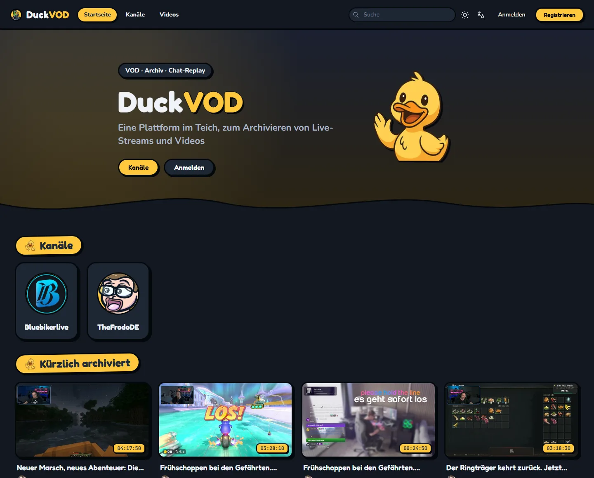
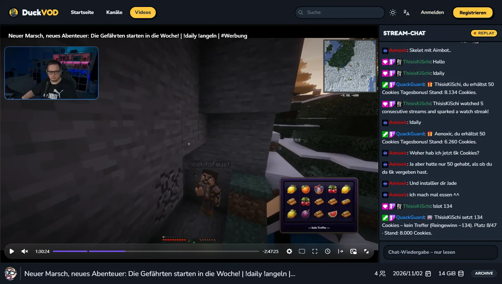
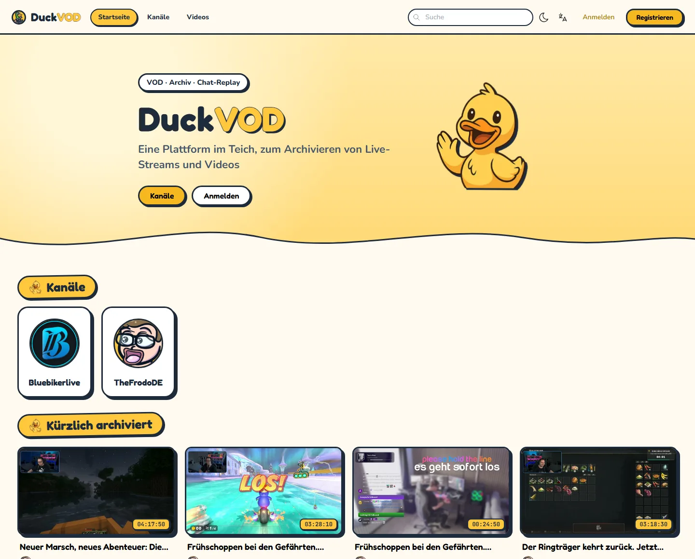
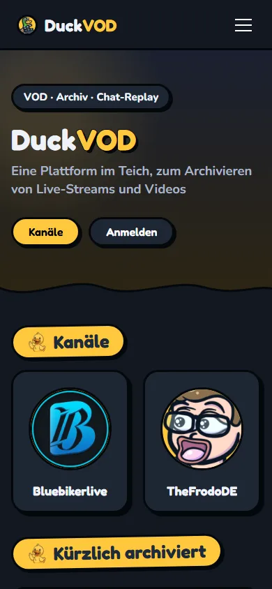

<br />
<div align="center">
  <a href="https://duckvod.de">
    
  </a>

  <h1 align="center">DuckVOD</h1>

  <p align="center">
    <b>Eine Plattform im Teich, zum Archivieren von Live-Streams und Videos.</b>
    <br />
    Twitch-VODs und Livestreams archivieren – mit Chat-Replay, das sich wie ein echter Stream-Chat anfühlt.
    <br />
    <br />
    <a href="https://duckvod.de"><b>duckvod.de</b></a>
    ·
    <a href="https://github.com/Zibbp/ganymede">Basiert auf Ganymede</a>
    ·
    Ein Projekt der DuckSquad Community
  </p>
</div>

---

## Screenshots

<p align="center">
  
</p>

<p align="center">
  
</p>

<table>
  <tr>
    <td width="70%"></td>
    <td width="30%"></td>
  </tr>
  <tr>
    <td align="center"><sub>Light Mode</sub></td>
    <td align="center"><sub>Mobile Ansicht</sub></td>
  </tr>
</table>

## Über DuckVOD

DuckVOD ist ein Fork von [Ganymede](https://github.com/Zibbp/ganymede) und archiviert vergangene Streams (VODs) und Livestreams von Twitch – inklusive Chat, der beim Abspielen in Echtzeit mitläuft, und einer gerendert eingebrannten Chat-Version für die Langzeitarchivierung. Alle Dateien werden in einer einfachen Ordnerstruktur gespeichert, sodass die Archive auch ohne DuckVOD nutzbar bleiben (siehe [Dateistruktur](https://github.com/Zibbp/ganymede/wiki/File-Structure)).

Gegenüber dem Original bringt DuckVOD unter anderem mit:

- 🦆 **DuckSquad-Design** mit verspielter Optik, Dark Mode als Standard und optionalem Light Mode.
- 💬 **Chat-Replay im Stream-Look** – Chat-Panel mit Kopfzeile, Replay-Badge und schreibgeschützter Eingabezeile.
- 📺 **Startseite mit Kanälen** und „Kürzlich archiviert“ direkt auf einen Blick, auf dem Handy als Karussell.
- 🇩🇪 **Deutsch als Standardsprache** (Englisch und Ukrainisch weiterhin verfügbar).
- ⚖️ **Impressum und Datenschutzerklärung** als eigene Seiten, auch bei aktivem Login-Zwang erreichbar.
- 🔎 **SEO** – Meta- und Open-Graph-Tags, `sitemap.xml`, `robots.txt` und strukturierte Daten.
- 📊 **Statistik-Seite** (`/statistiken`) mit Videos, Kanälen, Laufzeit und Archivgröße, nicht von Suchmaschinen indexiert.
- 🧪 **Testversions-Banner** auf Builds aus dem `dev`-Branch.

## Funktionen

- Chat-Wiedergabe in Echtzeit, synchron zum Video
- Chat-Histogramm zum Finden der spannendsten Stellen
- SSO / OAuth-Anmeldung ([Wiki](https://github.com/Zibbp/ganymede/wiki/SSO---OpenID-Connect))
- Dark / Light Mode
- „Beobachtete Kanäle“ – automatisches Archivieren vergangener Übertragungen und Livestreams, mit umfangreichen Filtern
- Unterstützung für Twitch-VODs und -Livestreams
- Verwaltung von Videos, Kanälen und Benutzern
- Eigene FFmpeg-Parameter für die Nachbearbeitung
- Eigene Parameter für das Chat-Rendering
- Webhook-Benachrichtigungen
- Einfache Dateistruktur für die Langzeitarchivierung
- Wiederherstellbares Warteschlangen-System
- Wiedergabefortschritt wird gespeichert
- Playlists

## Installation

### Voraussetzungen

- Linux-Umgebung mit Docker
- _Optional:_ Netzwerkspeicher (NFS/SMB)
- 50 GB+ freier Speicher, siehe [Speicheranforderungen](https://github.com/Zibbp/ganymede/wiki/Storage-Requirements)
- Eine Twitch-Anwendung – [Anwendung erstellen](https://dev.twitch.tv/console/apps/create)

### Einrichtung

DuckVOD besteht aus zwei Containern:

1. DuckVOD (API, Worker und Frontend)
2. PostgreSQL-Datenbank

Eine bereits vorhandene PostgreSQL-Instanz kann ebenfalls verwendet werden.

1. Die [`docker-compose.yml`](docker-compose.yml) herunterladen.
2. Die Umgebungsvariablen anpassen, siehe [Umgebungsvariablen](#umgebungsvariablen).
3. `docker compose up -d` ausführen.
4. Die konfigurierte Adresse aufrufen und mit Benutzername `admin` und Passwort `ganymede` anmelden.
5. Das Admin-Passwort ändern _oder_ einen neuen Benutzer mit Admin-Rechten anlegen und den `admin`-Benutzer löschen.

### Aktualisieren

```bash
docker compose pull
docker compose up -d
```

#### Stop Grace Period

Ein sauberes Herunterfahren kann bis zu ~80 Sekunden dauern. Die Beispiel-Compose-Datei setzt deshalb `stop_grace_period: 90s`; unter Kubernetes entsprechend `terminationGracePeriodSeconds: 90`.

Bei einem fatalen Prozessfehler beendet sich der Container mit Exit-Code `0`. Verwende daher die Restart-Policy `unless-stopped` oder `always`, nicht `on-failure`.

### Images

Die Images werden auf ghcr.io unter `ghcr.io/thefrodo/duckvod` veröffentlicht.

| Tag                   | Beschreibung                                                                     |
| --------------------- | -------------------------------------------------------------------------------- |
| `latest`              | Aktueller Stand des `main`-Branches – die stabile Version.                       |
| Semver, z. B. `5.0.1` | Ein bestimmtes Release.                                                          |
| `dev`                 | Aktueller Stand des `dev`-Branches zum Testen neuer Funktionen, mit Testbanner. |

### Rootless

Der Container kann als Nicht-Root-Benutzer laufen. Dazu die Umgebungsvariablen `PUID` und `PGID` auf den gewünschten Benutzer setzen. Mehr dazu in der [Dokumentation von linuxserver](https://docs.linuxserver.io/general/understanding-puid-and-pgid).

Hinweis: Beim Start führt der Container ein `chown` auf die Config-, Temp- und Logs-Verzeichnisse aus. Das Verzeichnis `/data/videos` wird **nicht** rekursiv angepasst – es muss für den gesetzten Benutzer lesbar sein.

Unterstützt der Speicher kein `chown` (z. B. NFS- oder SMB-Mounts wie TrueNAS mit NFSv4-ACLs), `SKIP_CHOWN=true` setzen. Die Verzeichnisse müssen dann bereits für den Benutzer beschreibbar sein.

### Konfiguration

Beim ersten Start wird eine Konfigurationsdatei erzeugt, standardmäßig unter `/data/config/config.json`. Alle Einstellungen stehen in [config.go](internal/config/config.go); die meisten lassen sich auch in der Weboberfläche unter **Admin › Einstellungen** ändern.

### Umgebungsvariablen

Die `docker-compose.yml` enthält Kommentare zu jeder Variable. Eine vollständige Liste mit Standardwerten steht in [env.go](internal/config/env.go).

##### Server

| Variable                                | Beschreibung                                                                                                                                                                       |
| --------------------------------------- | ---------------------------------------------------------------------------------------------------------------------------------------------------------------------------------- |
| `DEBUG`                                 | Debug-Logging aktivieren: `true` oder `false`.                                                                                                                                     |
| `VIDEOS_DIR`                            | Pfad zum Videoverzeichnis im Container. Standard: `/data/videos`.                                                                                                                  |
| `TEMP_DIR`                              | Pfad für temporäre Dateien während des Archivierens. Standard: `/data/temp`.                                                                                                       |
| `LOGS_DIR`                              | Pfad für Logdateien. Standard: `/data/logs`.                                                                                                                                       |
| `CONFIG_DIR`                            | Pfad für die Konfiguration. Standard: `/data/config`.                                                                                                                              |
| `SKIP_CHOWN`                            | _Optional:_ `chown` der Datenverzeichnisse beim Start überspringen, z. B. bei NFS/SMB. Standard: `false`.                                                                          |
| `PATH_MIGRATION_ENABLED`                | Pfadmigration beim Start aktivieren. Standard: `true`.                                                                                                                             |
| `TZ`                                    | Zeitzone, z. B. `Europe/Berlin`.                                                                                                                                                   |
| `DB_HOST`                               | Host der Datenbank.                                                                                                                                                                |
| `DB_PORT`                               | Port der Datenbank.                                                                                                                                                                |
| `DB_USER`                               | Benutzername der Datenbank.                                                                                                                                                        |
| `DB_PASS`                               | Passwort der Datenbank.                                                                                                                                                            |
| `DB_NAME`                               | Name der Datenbank.                                                                                                                                                                |
| `DB_SSL`                                | SSL verwenden. Standard: `disable`. Siehe [DB SSL](https://github.com/Zibbp/ganymede/wiki/DB-SSL).                                                                                 |
| `DB_SSL_ROOT_CERT`                      | _Optional:_ Pfad zum SSL-Root-Zertifikat der Datenbank. Siehe [DB SSL](https://github.com/Zibbp/ganymede/wiki/DB-SSL).                                                             |
| `TWITCH_CLIENT_ID`                      | Client-ID der Twitch-Anwendung.                                                                                                                                                    |
| `TWITCH_CLIENT_SECRET`                  | Client-Secret der Twitch-Anwendung.                                                                                                                                                |
| `OAUTH_ENABLED`                         | _Optional:_ OAuth aktivieren (`true`/`false`). Erfordert die übrigen OAuth-Variablen.                                                                                              |
| `OAUTH_PROVIDER_URL`                    | _Optional:_ URL des OAuth-Providers. Siehe [Wiki](https://github.com/Zibbp/ganymede/wiki/SSO---OpenID-Connect).                                                                   |
| `OAUTH_CLIENT_ID`                       | _Optional:_ OAuth-Client-ID.                                                                                                                                                       |
| `OAUTH_CLIENT_SECRET`                   | _Optional:_ OAuth-Client-Secret.                                                                                                                                                   |
| `OAUTH_REDIRECT_URL`                    | _Optional:_ OAuth-Redirect-URL, zeigt auf die API. Beispiel: `http://localhost:4000/api/v1/auth/oauth/callback`.                                                                   |
| `MAX_CHAT_DOWNLOAD_EXECUTIONS`          | Maximale Anzahl gleichzeitiger Chat-Downloads. Livestreams sind ausgenommen. Speicherintensiv (ca. 1,9 GB pro Ausführung), CPU vernachlässigbar.                                    |
| `MAX_CHAT_RENDER_EXECUTIONS`            | Maximale Anzahl gleichzeitiger Chat-Renderings. Sehr CPU-intensiv, ca. 500 MB RAM pro Ausführung.                                                                                  |
| `MAX_VIDEO_DOWNLOAD_EXECUTIONS`         | Maximale Anzahl gleichzeitiger Video-Downloads. Livestreams sind ausgenommen. Belastet Speicher und Netzwerk.                                                                      |
| `MAX_VIDEO_CONVERT_EXECUTIONS`          | Maximale Anzahl gleichzeitiger Video-Konvertierungen. Je nach FFmpeg-Parametern ressourcenintensiv.                                                                                |
| `MAX_VIDEO_SPRITE_THUMBNAIL_EXECUTIONS` | Maximale Anzahl gleichzeitiger Sprite-Thumbnail-Jobs. Ressourcenverbrauch gering.                                                                                                  |
| `DISABLE_LIVE_ARCHIVE_STALL_CHECK`      | Erkennung hängender Live-Aufnahmen (anhand des FFmpeg-Fortschritts) deaktivieren. Standard: `false`.                                                                               |
| `LIVE_ARCHIVE_STALL_TIMEOUT_SECONDS`    | Sekunden ohne FFmpeg-Fortschritt, bevor eine Live-Aufnahme gestoppt wird. Standard: `180`; Werte unter `30` nutzen den Standard.                                                   |

##### Frontend

| Variable                | Beschreibung                                                                                                                                         |
| ----------------------- | ---------------------------------------------------------------------------------------------------------------------------------------------------- |
| `SITE_URL`              | Öffentliche URL der Seite, z. B. `https://duckvod.de`. Wird für Canonical-Links, `sitemap.xml` und `robots.txt` genutzt. Fallback: Host der Anfrage. |
| `SHOW_TEST_BANNER`      | Testversions-Banner erzwingen (`true`) oder ausblenden (`false`). Standardmäßig automatisch an bei Images aus dem `dev`-Branch.                       |
| `DEFAULT_LOCALE`        | Sprache fest vorgeben (Kürzel, z. B. `de` oder `en`). Ohne Angabe gilt die gewählte Sprache des Besuchers, sonst Deutsch.                            |
| `SHOW_LOCALE_BUTTON`    | Sprachauswahl in der Navigation anzeigen (`true`/`false`). Standard: `true`.                                                                         |
| `SHOW_SSO_LOGIN_BUTTON` | „Mit SSO anmelden“-Button auf der Login-Seite anzeigen (`true`/`false`). Standard: `false`.                                                          |
| `FORCE_SSO_AUTH`        | Login-Seite überspringen und direkt per SSO anmelden (`true`/`false`). Standard: `false`.                                                            |
| `REQUIRE_LOGIN`         | Anmeldung zum Ansehen von Videos verlangen (`true`/`false`). Standard: `false`.                                                                      |
| `FORCE_LOGIN`           | Anmeldung für alle Seiten verlangen (`true`/`false`). Impressum und Datenschutz bleiben erreichbar. Standard: `false`.                               |

##### Datenbank

**Diese Werte müssen mit den Datenbank-Variablen des DuckVOD-Containers übereinstimmen.**

| Variable            | Beschreibung              |
| ------------------- | ------------------------- |
| `POSTGRES_PASSWORD` | Passwort der Datenbank.   |
| `POSTGRES_USER`     | Benutzername der Datenbank. |
| `POSTGRES_DB`       | Name der Datenbank.       |

### Volumes

| Volume         | Beschreibung                                                                                                                                         | Beispiel                     |
| -------------- | ---------------------------------------------------------------------------------------------------------------------------------------------------- | ---------------------------- |
| `/data/videos` | Speicherort der Videos. Muss mit `VIDEOS_DIR` übereinstimmen.                                                                                        | `/mnt/nas/vods:/data/videos` |
| `/data/logs`   | Logs der Warteschlangen-Jobs. Muss mit `LOGS_DIR` übereinstimmen.                                                                                    | `./logs:/data/logs`          |
| `/data/temp`   | Temporäre Dateien während des Archivierens. Liegt auf dem Host, damit Dateien nach einem Absturz wiederherstellbar sind. Muss mit `TEMP_DIR` übereinstimmen. | `./temp:/data/temp`          |
| `/data/config` | Konfiguration. Muss mit `CONFIG_DIR` übereinstimmen.                                                                                                 | `./config:/data/config`      |

## Dokumentation & API

- Ausführliche Dokumentation zu den Funktionen gibt es im [Ganymede-Wiki](https://github.com/Zibbp/ganymede/wiki).
- Die API-Dokumentation liegt im Ordner [docs](docs).

## Übersetzungen

Die verfügbaren Sprachen liegen in [frontend/messages](frontend/messages) (`de`, `en`, `uk`). Deutsch ist die Standardsprache, Englisch die Quelle für fehlende Schlüssel. Für eine neue Sprache eine `<sprache>.json` anlegen (z. B. `fr.json`) und sie im `languages`-Array in [Navbar.tsx](frontend/app/layout/Navbar.tsx) ergänzen. Mit `node frontend/translation-coverage.js` lässt sich prüfen, was übersetzt ist; die Option `-u` ergänzt fehlende Schlüssel.

## Entwicklung

Für die Entwicklung ist ein [Devcontainer](https://containers.dev/) enthalten. Danach startet das [Makefile](Makefile) die Entwicklungsumgebung:

- `make dev_server` – startet den Server
- `make dev_worker` – startet den Worker
- `make dev_web` – startet das Frontend

Weitere Befehle stehen im [Makefile](Makefile).

### Branches

| Branch | Zweck                                                                 |
| ------ | --------------------------------------------------------------------- |
| `dev`  | Neue Funktionen werden hier entwickelt und auf der Testinstanz geprüft. |
| `main` | Stabile Version, die live auf [duckvod.de](https://duckvod.de) läuft.  |

## Danksagungen

- [Ganymede](https://github.com/Zibbp/ganymede) von Zibbp – die Grundlage von DuckVOD
- [TwitchDownloader](https://github.com/lay295/TwitchDownloader)
- [yt-dlp](https://github.com/yt-dlp/yt-dlp)
- Hosting: [Nexosystems](https://nexo.systems/a/thefrodode)

## Lizenz

[GNU General Public License v3.0](LICENSE)
